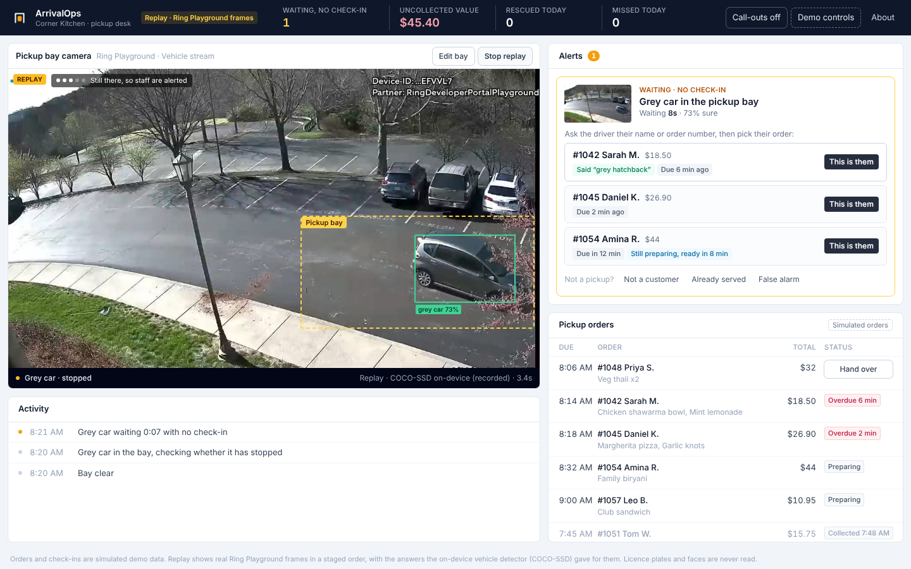

# ArrivalOps

**Ring-powered pickup exception management.** ArrivalOps catches the pickups your ordering system can't see, starting with its headline flow, **Unclaimed Pickup Rescue**: the customer who is waiting outside but never checked in.

A takeaway has three orders ready. A car pulls into the pickup bay, but the driver never taps "I'm here". Staff are busy, the food goes cold, and the customer phones in, annoyed, or drives off. Ordering systems like Toast and Square only know about customers who check in. **ArrivalOps handles the exception**: the shop's Ring camera notices a car waiting in the bay, ArrivalOps checks it against the ready orders that have no check-in, and staff get one clear card. They ask the driver's name, tap the order, hand it over, and the arrival-to-handover time is recorded.



## What it does

| Step | What happens | Built with |
|---|---|---|
| 1. Watch | The pickup desk streams the shop's Ring camera and samples frames inside the pickup bay the owner marked on the picture, so cars parked elsewhere are ignored. Only changed answers are sent on, plus a slow heartbeat, following Ring's guidance to filter early. | Ring Partner API: device discovery, WHEP live video |
| 2. Check | A vehicle detector runs in the staff browser every 3 seconds: is a vehicle in the bay, and has it moved since the last look? Coarse attributes only (body colour from pixels, car/truck/bus). When the AWS account allows it, Bedrock gives a second opinion on the bay crop with a strict JSON schema. Licence plates and people are never read. | COCO-SSD (SSDLite MobileNet v2, TensorFlow.js, model served by the app); optional Amazon Bedrock (Nova Lite, Converse API) |
| 3. Reconcile | One look can't tell a parked car from a passing one, so a first sighting is only "watched". Staff hear about it only when the camera has seen it at least twice, standing still in the same place, has seen it within the last 30 seconds, it has been there for the dwell time (1 minute by default), and some order due around now has no check-in. Elapsed time alone never raises an alert. Candidates include orders still being prepared, with the reason each one is listed ("Said ‘grey hatchback’", "Due 6 min ago", "Still preparing, ready in 8 min"). Repeat sightings fold into one case, and the activity feed records changes, not every frame. | `lib/arrivalops/reconcile.ts` |
| 4. Rescue | Staff see "Silver hatchback in the pickup bay · waiting 0:42" and up to three candidate orders, best guess first (for example, a customer who said "silver hatchback" at checkout). They confirm with the driver. ArrivalOps never contacts or identifies anyone on its own. | Staff desk (Next.js) |
| 5. Call out | If nobody acts within 45 seconds, the counter tablet chimes and says "A car is waiting in the pickup bay with no check-in." | Web Audio + speech |
| 6. Measure | Uncollected value (the sale value of ready orders past pickup time with no check-in: money on the shelf, not a measured loss), cars rescued today, median alert-to-staff time, arrival-to-handover, and **Missed today**: a car that drives off after the alert is shown as "left before anyone came out", and counts as a missed pickup only when staff confirm it was a customer. | `lib/arrivalops/metrics.ts` |

Every staff action can be undone, settings (bay, dwell, call-out delay) are per shop, and a customer who checks in late through the app closes the case automatically.

## Why it matters

- Pickup and curbside are now a normal part of restaurant and retail sales, and every one of those businesses runs on the assumption that customers announce themselves.
- When they don't, the cost is concrete: food remade or thrown away, a refund, a one-star review, and a lost regular. The "Uncollected value" tile shows the sale value sitting on the shelf at any moment.
- The shop already owns the camera. ArrivalOps turns a security device into an operations tool without new hardware, which suits small shops that will never buy a dedicated license-plate system.

## Try it

**Hosted demo (no account or token needed): [arrivalops.vercel.app](https://arrivalops.vercel.app)**. It opens in **Replay** mode: real frames from the Ring Developer Playground *Vehicle* stream played in a staged order (the Playground clip has no car that arrives and waits). Its vehicle answers are the real output of the same on-device detector, recorded on those frames by `scripts/record-detections.ts`. Press **Play recorded arrival**. The driver waits until you match them to their order. To see a missed pickup instead, press **Driver gives up and leaves** in Demo controls. Each visitor gets their own private board, kept in their own browser (the hosted demo runs the desk's API in the page, so no server holds anyone's clicks), and the **Demo controls** panel stands in for the ordering system (a customer tapping "I'm here", restarting the lunch rush). Demo timings are shortened (6 s dwell, 20 s call-out) and say so on screen.

**Run it yourself:**

```bash
npm install
cp .env.example .env.local     # add RING_ACCESS_TOKEN for live mode; leave empty for replay
npm run dev                    # http://localhost:3000
npm test                       # reconciliation, vision parsing and API tests
```

| Variable | Purpose |
|---|---|
| `RING_ACCESS_TOKEN` | Token from the [Ring Developer Playground](https://developer.amazon.com/ring/console/playground). Switches the desk to **Live** mode. |
| `AWS_REGION`, AWS credentials | Optional. Bedrock second opinion for live frames (default region `us-east-1`). Without them the on-device detector does the job alone. |
| `VISION_PROVIDER` | `on-device` to never call Bedrock. Unset: Bedrock is tried with the usual AWS credential chain, and the detector's answer is used whenever Bedrock refuses or is unreachable (Bedrock then rests for 10 minutes). |
| `BEDROCK_MODEL_ID` | Defaults to `us.amazon.nova-lite-v1:0`. |
| `ARRIVALOPS_DATA_DIR` | Optional folder to persist the board across restarts. |
| `NEXT_PUBLIC_ARRIVALOPS_IN_BROWSER` | `1` runs the replay demo entirely in the visitor's browser (set automatically on Vercel). Live Ring mode needs the server, so leave it unset there. |
| `NEXT_PUBLIC_SHOP_NAME`, `NEXT_PUBLIC_CURRENCY` | Branding for the desk. |

## What's real and what's simulated

Judges should never have to guess, so here it is plainly:

| Part | Status | Evidence |
|---|---|---|
| Ring device discovery and WHEP live video (Ring Partner API, Developer Playground) | **Real**, in live mode on a local machine | `app/api/ring/`, `app/hooks/useWebRTCStream.ts`; live screenshots in `docs/screenshots/` |
| Vehicle detection | **Real**: COCO-SSD runs in the browser on each live frame; replay shows its real recorded output on the replay frames | `lib/arrivalops/detector.ts`, `scripts/record-detections.ts`, `lib/arrivalops/replayDetections.json` |
| Replay footage | **Real Ring Playground frames, shown in a staged order.** The Playground clip never shows a car arriving and waiting, so the sequence is arranged; the desk labels it REPLAY | `public/replay/manifest.json` (capture times and provenance) |
| Arrival trigger | The Playground's sessions appear in Ring event history as on-demand views, **not motion or vehicle events**. No Ring webhook triggered anything; the desk samples the stream itself | [FRICTION_LOG.md](FRICTION_LOG.md) |
| Orders, customers, phone numbers, "I'm here" check-ins | **Simulated** demo data, labelled on screen. No POS is connected | `lib/arrivalops/seed.ts` |
| Reconciliation, cases, metrics, undo, staff actions | **Real application logic**, the same code on the server and in the hosted demo | `lib/arrivalops/reconcile.ts`, `store.ts`, `api.ts`; 50 tests |
| Amazon Bedrock (Nova Lite) second opinion | **Built but currently unavailable**: every call from our AWS account returns `ValidationException: Operation not allowed` (support case open). The desk falls back to the detector and says so | `lib/arrivalops/vision.ts` |

ArrivalOps never identifies a person or reads a licence plate. Staff confirm the order with the driver; the app only suggests which ready orders could fit, with the reason for each.

## Architecture

```
Ring camera (Developer Playground)
   │  WHEP live video (Ring Partner API)
   ▼
Staff desk (browser): on-device detector (COCO-SSD) on the marked bay
   │  changed answers only, with the bay crop
   ▼
/api/arrivalops/observe ── optional second opinion: Bedrock Converse (Nova Lite), 8 s timeout, schema-checked
                                                  │
                                                  ▼
                                    reconcile: waiting car × due orders without check-in
                                                  │
          needs review ─▶ staff confirm the order with the driver ─▶ handed over   (or dismissed / closed by late check-in)
                     └─ car leaves ─▶ "left before anyone came out" ─▶ staff: missed pickup, or not a customer
                                                  │
                                         metrics + activity log
```

Built on Amazon's [ring-api-helloworld](https://github.com/AmazonAppDev/ring-api-helloworld) sample (MIT). The original sample dashboard is still available at `/sample`.

## Built during the hackathon

Everything under `lib/arrivalops/`, `app/components/desk/`, `app/hooks/useArrivalOps.ts`, `app/hooks/useFrameSampler.ts`, `app/api/arrivalops/` and the new `app/page.tsx` was written for Build, Ship, Shape (October 2026). Amazon's sample provided the Ring authentication, device discovery and WHEP streaming code.

## License

MIT. See [LICENSE](LICENSE).
