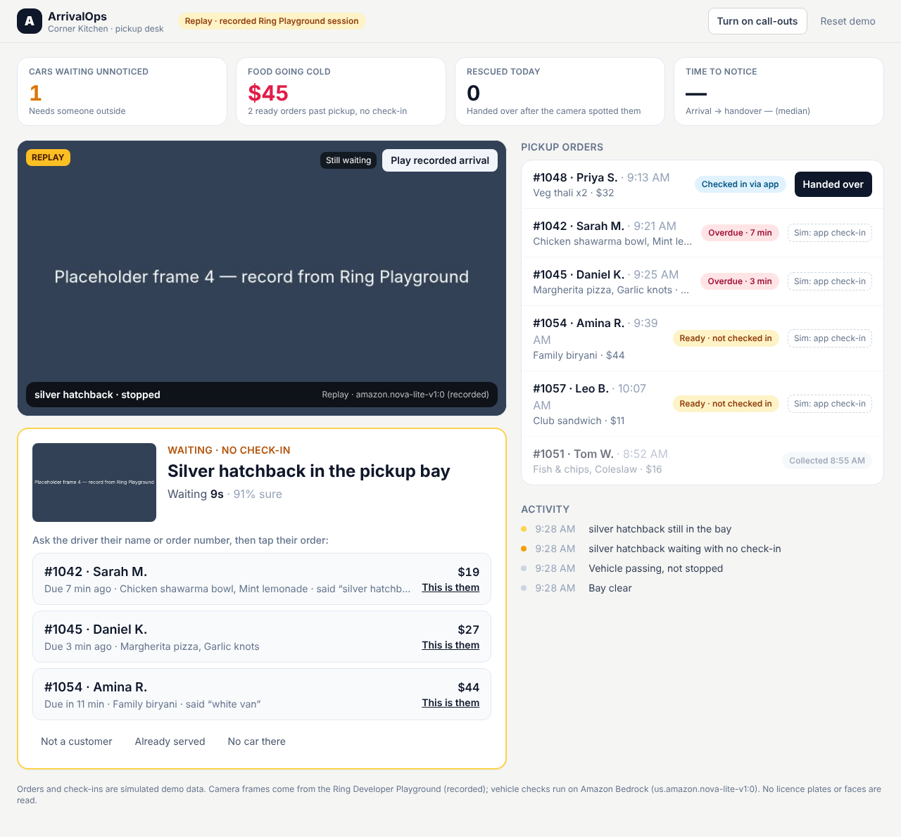

# ArrivalOps

**See the customer who never checked in.** Ring-powered curbside rescue for small businesses.

A takeaway has three orders ready. A car pulls into the pickup bay, but the driver never taps "I'm here". Staff are busy, the food goes cold, and the customer phones in, annoyed, or drives off. Ordering systems like Toast and Square only know about customers who check in. **ArrivalOps covers the ones who don't**: the shop's Ring camera notices a car waiting in the bay, ArrivalOps checks it against the ready orders that have no check-in, and staff get one clear card. They ask the driver's name, tap the order, hand it over, and the arrival-to-handover time is recorded.



## What it does

| Step | What happens | Built with |
|---|---|---|
| 1. Watch | The pickup desk streams the shop's Ring camera and samples frames. Only frames where the scene changed are sent on, plus a slow heartbeat, following Ring's guidance to filter early. | Ring Partner API: device discovery, WHEP live video |
| 2. Check | One narrow question goes to a Bedrock vision model: is a vehicle *waiting* in the bay? Coarse attributes only (colour, body type). Licence plates and people are never read, and output is validated against a strict schema. | Amazon Bedrock (Nova Lite, Converse API) |
| 3. Reconcile | A car that's waiting is matched against ready orders with no check-in that are due around now. If every waiting customer already checked in, nothing happens. Repeat sightings fold into one case. | `lib/arrivalops/reconcile.ts` |
| 4. Rescue | Staff see "Silver hatchback in the pickup bay · waiting 0:42" and up to three candidate orders, best guess first (for example, a customer who said "silver hatchback" at checkout). They confirm with the driver. ArrivalOps never contacts or identifies anyone on its own. | Staff desk (Next.js) |
| 5. Call out | If nobody acts within 45 seconds, the counter tablet chimes and says "A car is waiting in the pickup bay with no check-in." | Web Audio + speech |
| 6. Measure | Food going cold (value of overdue, unclaimed orders), cars rescued today, median time to notice, and median arrival-to-handover. | `lib/arrivalops/metrics.ts` |

Every staff action can be undone, and a customer who checks in late through the app closes the case automatically.

## Why it matters

- Pickup and curbside are now a normal part of restaurant and retail sales, and every one of those businesses runs on the assumption that customers announce themselves.
- When they don't, the cost is concrete: food remade or thrown away, a refund, a one-star review, and a lost regular. The "Food going cold" tile puts a number on it every minute of the day.
- The shop already owns the camera. ArrivalOps turns a security device into an operations tool without new hardware, which suits small shops that will never buy a dedicated license-plate system.

## Try it

**Hosted demo (no account needed):** _link added at submission_. It opens in **Replay** mode: a recorded run of the Ring Developer Playground *Vehicle* stream, with the Bedrock answers captured during recording. Press **Play recorded arrival**, then work the case.

**Run it yourself:**

```bash
npm install
cp .env.example .env.local     # add RING_ACCESS_TOKEN for live mode; leave empty for replay
npm run dev                    # http://localhost:3000
npm test                       # reconciliation, vision parsing and API tests
```

| Variable | Purpose |
|---|---|
| `RING_ACCESS_TOKEN` | Token from the [Ring Developer Playground](https://developer.amazon.com/ring/console/playground). Switches the desk to **Live** mode. |
| `AWS_REGION`, AWS credentials | Bedrock access for live frames (default region `us-east-1`). |
| `BEDROCK_MODEL_ID` | Defaults to `us.amazon.nova-lite-v1:0`. |
| `ARRIVALOPS_DATA_DIR` | Optional folder to persist the board across restarts. |
| `NEXT_PUBLIC_SHOP_NAME`, `NEXT_PUBLIC_CURRENCY` | Branding for the desk. |

## What's real and what's simulated

Judges should never have to guess, so here it is plainly:

| Real | Simulated (and labelled in the UI) |
|---|---|
| Ring Partner API calls: device discovery and WHEP live video from the Developer Playground | Orders, customers and "I'm here" app check-ins (demo data; no POS connection in this build) |
| Amazon Bedrock vision calls on frames from that video | Replay mode re-plays a recorded Playground session for visitors without a Ring token |
| Reconciliation, metrics, undo and the staff desk | The Playground's simulated streams appear in Ring event history as on-demand views, not motion events, so live mode samples the stream itself instead of waiting for a webhook |

## Architecture

```
Ring camera (Developer Playground)
   │  WHEP live video (Ring Partner API)
   ▼
Staff desk (browser) ── changed frames only ──▶ /api/arrivalops/observe
                                                  │  Bedrock Converse (Nova Lite), 8 s timeout, schema-checked
                                                  ▼
                                    reconcile: waiting car × due orders without check-in
                                                  │
                     needs review ─▶ matched ─▶ handed over   (or dismissed / closed by late check-in)
                                                  │
                                         metrics + activity log
```

Built on Amazon's [ring-api-helloworld](https://github.com/AmazonAppDev/ring-api-helloworld) sample (MIT). The original sample dashboard is still available at `/sample`.

## Built during the hackathon

Everything under `lib/arrivalops/`, `app/components/desk/`, `app/hooks/useArrivalOps.ts`, `app/hooks/useFrameSampler.ts`, `app/api/arrivalops/` and the new `app/page.tsx` was written for Build, Ship, Shape (October 2026). Amazon's sample provided the Ring authentication, device discovery and WHEP streaming code.

## License

MIT. See [LICENSE](LICENSE).
