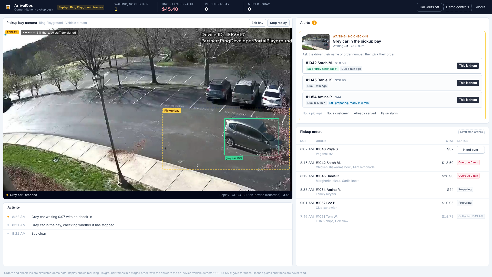

# ArrivalOps

Pickup exception management powered by Ring video.

**[Live demo](https://arrivalops.vercel.app) | [Demo video (2:13)](https://youtu.be/xVGru7-7Pkk) | [Ring starter contribution (PR #49)](https://github.com/AmazonAppDev/ring-api-helloworld/pull/49)**



## The problem

An order can be ready for collection while the customer is waiting outside. If the customer does not check in, the restaurant's ordering system may have no record of their arrival, even when a camera overlooks the pickup area.

ArrivalOps uses the camera as another source of information. It looks for a vehicle waiting in a designated pickup bay, checks for orders without a recorded check-in, and brings the possible mismatch to a member of staff. It does not identify the driver or assume that every vehicle belongs to a customer.

## How it works

1. **Mark the pickup bay.** Staff draw a zone on the camera view. Vehicles outside that area do not trigger pickup cases.
2. **Observe vehicles.** In live mode, the application receives video through the Ring Partner API's WHEP interface. COCO-SSD runs in the staff browser, checking the zone approximately every three seconds.
3. **Check for a sustained stop.** A single frame cannot establish that a car is waiting. ArrivalOps requires repeated observations, evidence that the vehicle is stationary, a recent sighting (within 30 seconds), and the configured dwell period (60 seconds by default).
4. **Review the possible pickup.** If relevant orders have no recorded check-in, the desk opens a case with the observed vehicle, waiting time, and up to three candidate orders. Pickup timing and any customer-provided vehicle hint help rank the candidates. These are suggestions, not identifications.
5. **Confirm the handoff.** Staff ask the driver to confirm their order. They can match it, mark it handed over, dismiss the observation, or undo a recent action. An optional spoken call-out reminds staff about an unanswered case.
6. **Handle departures.** If a vehicle leaves before the case is resolved, ArrivalOps records the departure for review. It counts as a missed pickup only if staff confirm that it was a customer.

The desk also shows rescued orders, time from alert to staff confirmation, arrival-to-handover time, and the sale value of overdue ready orders without a check-in. **Uncollected value is not a calculation of lost revenue or food waste.**

## Try the demo

**Open [arrivalops.vercel.app](https://arrivalops.vercel.app).** No account, Ring token, or AWS credentials are required.

The hosted version runs in replay mode, with each visitor's board stored in their own browser. To follow the main scenario:

1. Select **Play recorded arrival**.
2. Watch the vehicle observation and the pickup exception appear.
3. Review the candidate orders, confirm the customer's order, and mark it handed over.
4. Try **Undo**, or use the demo controls to replay the arrival and have the driver leave.
5. Edit the pickup bay and observe how vehicles outside the marked area are ignored.

Replay timings are shortened to a six-second dwell period and a 20-second call-out delay. The production defaults are 60 and 45 seconds respectively.

## What is real, recorded, or simulated?

| Component | What the demo demonstrates |
| --- | --- |
| Ring integration | Device discovery and WHEP live streaming were tested with the Ring Developer Playground on a local Mac. Live mode requires an active Ring session and credentials. |
| Vehicle detection | TensorFlow.js and COCO-SSD analyze live frames in the browser. Replay uses previously recorded outputs from the same detector on the included Ring frames. |
| Replay footage | The images came from a genuine Ring Developer Playground Vehicle stream, but their order and timing are staged. The source video does **not** show the complete arrival-and-wait scenario presented by the replay. See [the capture manifest](public/replay/manifest.json). |
| Pickup orders | Customers, orders, check-ins, and telephone numbers are simulated. No point-of-sale system is connected. |
| Exception workflow | Reconciliation, candidate ranking, case handling, staff actions, and metrics run as application code in both modes. |
| Ring events | Playground sessions were recorded as `on_demand` viewing events, not vehicle-motion webhooks. ArrivalOps samples video frames rather than claiming a Ring vehicle-arrival event. See [the friction log](FRICTION_LOG.md). |
| Amazon Bedrock | Optional second opinion on a cropped frame. Testing through the Bedrock Mantle API with Gemma 3 12B returned both a correct vehicle description and a false positive on a clear bay. The on-device detector remains authoritative. |

The replay is intended to let someone evaluate the workflow without live hardware or expiring Playground credentials. It should not be interpreted as footage of an actual restaurant pickup or a successful customer identification.

## Implementation

The application is built with Next.js 15, React, TypeScript, TensorFlow.js, COCO-SSD, WebRTC/WHEP, and optional Amazon Bedrock image analysis.

- **Ring:** `app/api/ring/` handles device discovery and video-session requests. `app/hooks/useWebRTCStream.ts` manages the browser's WebRTC session.
- **Detection:** `app/hooks/useFrameSampler.ts` samples the live feed and `lib/arrivalops/detector.ts` interprets vehicle detections in the marked zone.
- **Reconciliation:** `lib/arrivalops/reconcile.ts` manages dwell checks, candidate orders, case transitions, and staff verification.
- **State and metrics:** `lib/arrivalops/store.ts` and `lib/arrivalops/metrics.ts` manage the desk and reporting.
- **Browser replay:** `lib/arrivalops/browserApi.ts` uses the same domain logic for the hosted demo, without relying on server memory to retain visitor state.
- **Bedrock:** `lib/arrivalops/vision.ts` checks cropped frames through the Bedrock Mantle API or Converse API when configured. Its result is displayed as agreement or disagreement and cannot independently raise or clear an alert.

In live mode, the system needs an active staff-browser viewing session to process video. It is a working prototype, not a continuously operating unattended camera service.

## Run locally

Requires Node.js and npm.

```bash
npm install
cp .env.example .env.local
npm run dev
```

Open [http://localhost:3000](http://localhost:3000). Without Ring credentials, the application opens in replay mode.

To test live mode, add a valid `RING_ACCESS_TOKEN` from the [Ring Developer Playground](https://developer.amazon.com/ring/console/playground) to `.env.local`, then restart the application. Keep credentials local and never commit them.

Useful commands:

```bash
npm test             # reconciliation, detection, replay, and other automated tests
npm run lint
npm run typecheck
npm run build
npm run bedrock:check # requires a configured Bedrock connection
```

### Configuration

| Variable | Purpose |
| --- | --- |
| `RING_ACCESS_TOKEN` | Playground access token for local live mode. The inherited Ring integration also supports a refresh-token configuration. |
| `BEDROCK_API_KEY` | Optional API key for the Bedrock Mantle endpoint. Keep it in `.env.local`. |
| `BEDROCK_MODEL_ID` | Optional model override. Defaults to `google.gemma-3-12b-it` when using a Bedrock API key, or `us.amazon.nova-lite-v1:0` with the Converse API. |
| `AWS_REGION`, AWS credentials | Region and authentication for the Converse path when no Bedrock API key is configured. |
| `VISION_PROVIDER` | Set to `on-device` to disable Bedrock requests. Without this setting, the application attempts Bedrock and falls back if unavailable. |
| `ARRIVALOPS_DATA_DIR` | Optional directory for persisting the live shop board on disk. |
| `NEXT_PUBLIC_ARRIVALOPS_IN_BROWSER` | `1` runs the replay desk in the browser. This is enabled automatically for Vercel builds. |
| `NEXT_PUBLIC_SHOP_NAME`, `NEXT_PUBLIC_CURRENCY` | Shop name and display currency. |

## Testing notes

The [friction log](FRICTION_LOG.md) and [timestamped Mac testing log](docs/FRICTION_LOG_MAC.md) document Ring and Bedrock integration work, including short Playground sessions, frozen video, on-demand event history, and model-access problems.

The Ring starter also received a related fix from this project: [AmazonAppDev/ring-api-helloworld PR #49](https://github.com/AmazonAppDev/ring-api-helloworld/pull/49), which detects stalled streams and offers a Reconnect action.

## Credits and license

ArrivalOps was developed for Amazon Build, Ship, Shape 2026 using Amazon's [Ring Hello World sample](https://github.com/AmazonAppDev/ring-api-helloworld) as its integration starting point. The original sample dashboard remains available at `/sample`.

Licensed under the terms in [LICENSE](LICENSE) (MIT).
